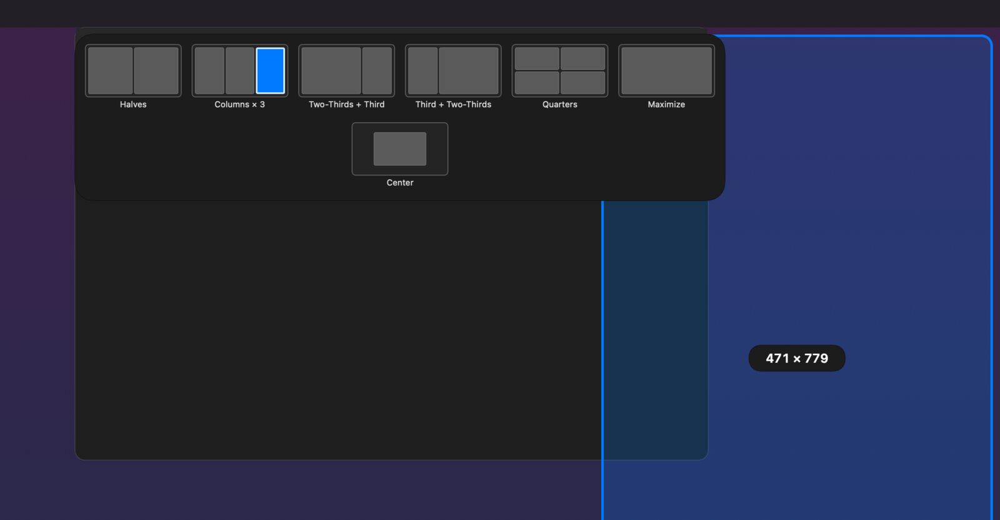
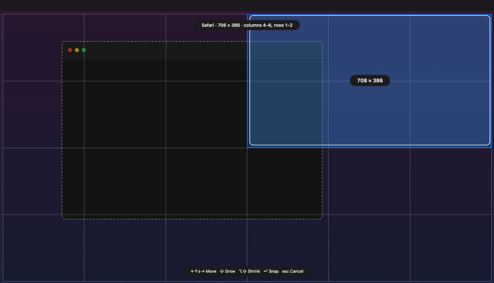
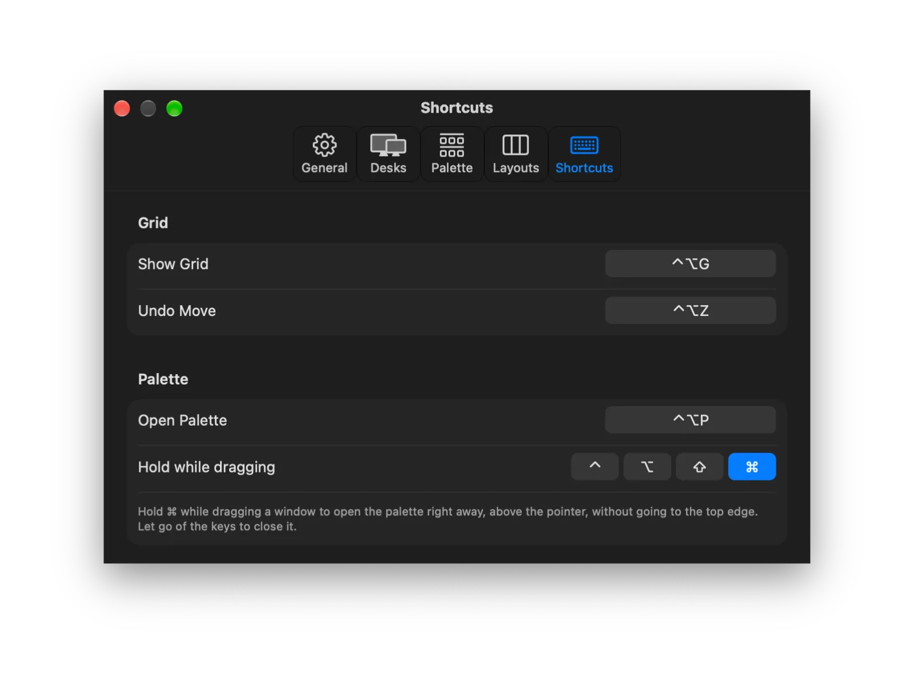
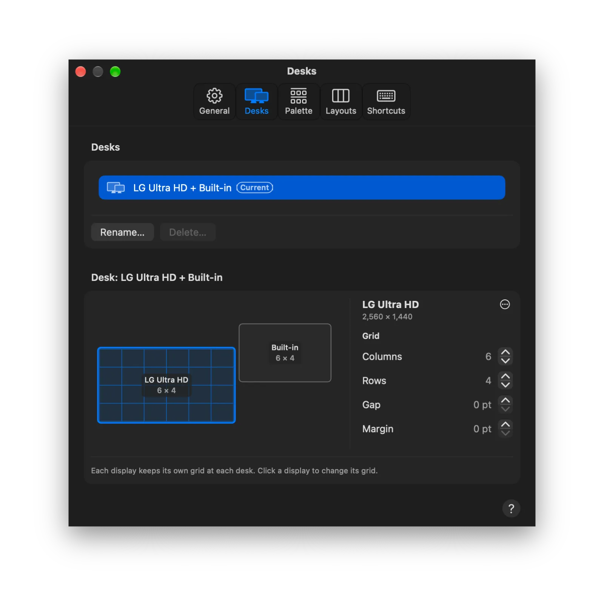
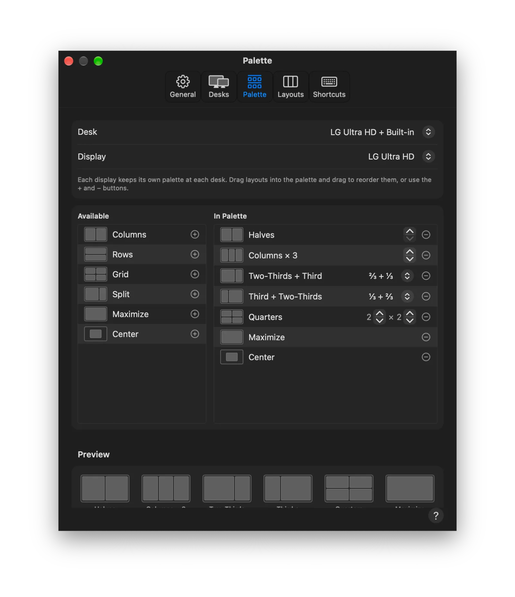

# GridLock

GridLock puts windows exactly where you want them on your Mac. Drag a window to the top of a display and a palette of layouts drops down: let go over a zone and the window snaps into it. Or press a shortcut, see the frontmost window on a grid, and draw the cells it should fill.

It also remembers every desk you work at. A desk is a set of connected displays, recognized by their serial numbers, so the same laptop can have one grid and palette at home and another at the office, and GridLock switches between them on its own when you plug in.

<p align="center"></p>

## Download

### [⬇ Download GridLock for Mac](https://github.com/smanke-org/GridLock/releases/latest/download/GridLock.dmg)

1. Open `GridLock.dmg`.
2. Drag GridLock to Applications.
3. Open GridLock, then allow it under System Settings › Privacy & Security › Device Control and Data Access (Accessibility on older macOS). It needs this to move other apps' windows.

Requires macOS 26 or later. Free.

## Features

- **The palette.** Drag a window by its title bar to the top edge of a display. Each layout in the palette is split into zones; drag over one to preview where the window goes, and let go to snap it.
- **No top edge needed.** Hold ⌘ (or any keys you choose) while dragging and the palette opens right away, next to the pointer, so Mission Control never gets in the way. Or press ⌃⌥P to open the palette for the frontmost window and click a zone.
- **Show Grid.** Press ⌃⌥G to see the frontmost window's cells on a grid. Drag across cells or use the arrow keys (⇧ grows, ⌥⇧ shrinks), then let go or press Return.
- **Per desk, per display.** Each display at each desk keeps its own grid (columns, rows, gap, margin) and its own palette. A new desk starts from the most similar one GridLock knows.
- **Your palette.** Choose which layouts appear and in what order: halves, columns, rows, grids, splits, maximize, center, each family with its own count, plus custom layouts you draw yourself.
- **Shortcuts for everything.** Every zone can have a shortcut; pressing a half's shortcut again steps through two-thirds and a third. Move a window to the next display and keep its share of the grid.
- **Undo Move.** ⌃⌥Z puts the last window GridLock moved back where it was, up to 10 moves back.
- **Works with your other apps.** `gridlock://` links for scripts and Shortcuts, buttons in ToolHUD, and its shortcuts listed in ShortcutsLens.
- **A command line for scripts and AI agents.** `gridlock` lists displays, desks, layouts and windows, snaps windows, and changes grids and settings in the running app.
- **The usual comforts.** Light or dark appearance, menu bar and Dock icons you can hide, open at login, settings that follow you to your other Macs over iCloud (custom layouts, and each desk's grids and palettes, too), and Help built in (⌘?).

GridLock never changes macOS's own window tiling. If "Drag windows to screen edges to tile" is on, Settings › General says so and opens the right page of System Settings.

## Screenshots

<table>
<tr>
<td width="50%"><br><sub><b>Show Grid.</b> Draw the cells a window should fill, or move the selection with the arrow keys.</sub></td>
<td width="50%" align="center"><br><sub><b>Shortcuts.</b> Open Palette, and the keys to hold while dragging.</sub></td>
</tr>
<tr>
<td width="50%" align="center"><br><sub><b>Desks.</b> Each display at each desk keeps its own grid.</sub></td>
<td width="50%" align="center"><br><sub><b>Palette.</b> Choose a display's layouts, their counts and their order.</sub></td>
</tr>
</table>

### Command line and AI agents

GridLock is also a command line tool, so scripts and AI agents (Claude Code, Codex) can see your displays, desks, grids and
layouts, list windows, snap a window to a zone, a layout or grid cells, undo a move, and change grids and settings.
Commands run in the open app, through the same code as the palette, the grid and Settings, so Undo Move works on them.
Link it once to type `gridlock`:

```bash
ln -s /Applications/GridLock.app/Contents/MacOS/GridLock ~/.local/bin/gridlock
```

```bash
gridlock help
gridlock displays list
gridlock windows snap --zone left-half --app Safari
gridlock layouts apply "Two-Thirds + Third" --zone 2 --app Safari
gridlock grid set --display 1 --columns 12 --gap 8
```

Every command takes `--json`. Without `--app`, snapping acts on the frontmost window, which is Terminal's when you run it
there. Resetting a display's grid and palette only shows what it would change until you add `--yes`. For MCP apps such as
Claude Desktop, the same commands are served by `/Applications/GridLock.app/Contents/MacOS/GridLock mcp`:

```bash
claude mcp add --scope user gridlock -- /Applications/GridLock.app/Contents/MacOS/GridLock mcp
```

## Updates

GridLock checks GitHub for new versions once a day by default. Settings › General lets you install updates automatically, be asked first, or not check at all; the menu bar menu has Check for Updates… Each update shows what changed.

## Building

GridLock is a Swift package (Swift 6.2 tools, macOS 26 SDK).

```bash
swift test          # unit tests for GridLockKit
./build_app.sh      # signed GridLock.app in .build/app
```

Desks are stored in `~/Library/Application Support/GridLock/desks.json` and mirrored to `iCloud Drive/GridLock/Macs/<this Mac>/`.

## License

© 2026 Steve Manke. All rights reserved.
